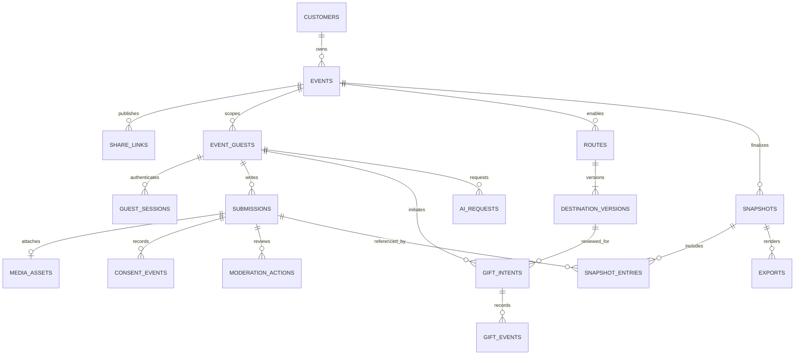

# Database design and module ownership

**Version:** 13 October 2026. **Decision:** [ADR 0005](../adr/0005-database-design.md).

Use one managed PostgreSQL database per environment and private object storage for photos and exports. Evaluate Supabase first because it already appears in the financial reference; the provider, PostgreSQL version, identity integration and connection adapter must pass the deployment spike in [ADR 0001](../adr/0001-production-stack.md). This is a production design contract, not an installed database. Implementation belongs to DCB-E18 and the existing domain stories; the UI remains sample-only.

## Scope and conventions

A **customer** is a registered host or separately authorized operator. Do not create parallel users/hosts/customers copies. An **event guest** is an anonymous identity scoped to one event, independent of their expiring session; no account or email is required. Names are not identity keys. Becoming a customer does not automatically link private contributions across events.

October **gift records** represent intended gifts, exact reviewed destination versions, handoff issuance and optional host receipt confirmation. DigitalCardBox cannot observe the external transfer. Later **product purchase transactions** and **integrated gift transactions** have separate tables and approval gates; no generic transactions table mixes clicks, orders, transfers and payouts. Gift principal is never product revenue.

Entity IDs are opaque server-generated UUIDs. Mutable entities have `created_at`, `updated_at` and an incrementing `row_version`; immutable history has `created_at` and ordered sequence where needed. Instants use `timestamptz`; event calendar dates use `date` plus an IANA timezone. Money uses nonnegative `bigint` minor units and uppercase ISO currency, never floating point. Optional external intended amounts are positive when supplied and are not receipt amounts. Columns below are required unless marked `?`; PK/FK/UQ mean primary key/foreign key/unique constraint. Apply bounded text, JSON shape and enum checks. JSONB stores bounded style options or allowlisted metadata, not whole domain objects.

Module schemas are `identity`, `events`, `cards`, `ai`, `gifts`, `book`, plus infrastructure `platform`. Migrations may enforce reviewed FKs to another module's stable public ID. Runtime modules still use public application interfaces and their own repositories; FKs do not authorize private-table reads or ORM traversal. A composition-layer unit of work lets public module adapters share a transaction. See [ADR 0002](../adr/0002-modular-backend.md).

## October table dictionary

These 23 tables include four infrastructure tables. Migration-runner bookkeeping is tool-owned, not another application schema catalog.

### Identity: customers and event-scoped guests

| Table | Columns beyond shared fields | Keys and purpose |
| --- | --- | --- |
| `identity.customers` | `id`, `auth_issuer`, `auth_subject`, `email`, `email_verified_at?`, `display_name`, `account_role`, `disabled_at?` | PK id; UQ (auth_issuer, auth_subject). Role host or separately provisioned operator; provider-synchronized email is for notifications, not an ownership key. No passwords/MFA secrets. |
| `identity.event_guests` | `id`, `event_id`, `display_name?`, `erased_at?` | PK id; FK event; UQ (event_id, id). The only guest profile; no global guest list or matching by email/name. Separate browsers may be separate anonymous guests; this is not a verified person count. |
| `identity.guest_sessions` | `id`, `event_id`, `guest_id`, `share_link_id`, `token_hash`, `expires_at`, `revoked_at?` | PK id; UQ token_hash; same-event composite FKs to guest and share link. Store only token hash; bearer secret stays in a secure cookie. Index expiry. Durable content references guest, so deleting sessions cannot erase accepted data. |

Managed identity owns host sessions and fresh-authentication evidence. Do not duplicate its password/session tables. If the selected adapter needs a backend session store, record that in ADR 0001 before adding it. Event ownership is events.owner_customer_id; co-host membership is outside current scope. Operators never gain blanket private-content access from their role.

### Events: ownership, dates and share links

| Table | Columns beyond shared fields | Keys and purpose |
| --- | --- | --- |
| `events.events` | `id`, `owner_customer_id`, `title`, `recipient_display_name`, `occasion_type`, `lifecycle_kind`, `event_date?`, `timezone`, `opens_at`, `contributions_close_at`, `gifts_close_at`, `published_at?`, `revoked_at?`, `window_locked_at?`, `policy_version` | PK id; FK customer; index (owner_customer_id, created_at, id). Kind wedding/dated_other/undated; occasion labels do not grant wedding extensions. Check ordered windows and date/kind consistency. Events alone derives deadlines. |
| `events.share_links` | `id`, `event_id`, `generation`, `token_hash`, `token_ciphertext`, `encryption_key_version`, `revoked_at?` | PK id; UQ token_hash, (event_id, generation), (event_id, id); partial UQ one unrevoked link per event. Encrypt recoverable secret for repeated host copy/QR; resolve URLs by hash. Rotation revokes old links and their guest sessions. |

At each server write, after taking the event lock, use a fresh authoritative clock and `opens_at <= now < applicable_close_at`, subject to publication/revocation. Derive calendar boundaries in the event timezone, including DST/month-end tests; lifecycle stories must specify their exact conversion. Do not store a scheduled/active/closed flag that goes stale with time. Dated events open no earlier than six calendar months before the date; contributions close at day 90, and only weddings keep gifts through month 12. Undated pages close within 90 days of publication.

The first accepted contribution or created gift intent locks date/closing-window edits in the same transaction. Revocation can close earlier. Expired/revoked URLs can render a safe closed page without granting writes or host access. Ordinary closure never deletes private host records.

### Cards: unified content with explicit consent and moderation

| Table | Columns beyond shared fields | Keys and purpose |
| --- | --- | --- |
| `cards.submissions` | `id`, `event_id`, `guest_id`, `kind`, `text`, `template_key?`, `template_version?`, `style_json?`, `submitted_at?`, `content_state`, `removed_at?` | PK id; same-event guest FK; UQ (event_id, id). Kind note/card; state draft/submitted/hidden/removed. Template/version required for styled card. One submission is one book entry; no required gift reference. Index (event_id, submitted_at, id). |
| `cards.media_assets` | `id`, `event_id`, `guest_id`, `submission_id?`, `object_key`, `mime_type`, `byte_size`, `width`, `height`, `scan_state`, `deleted_at?` | PK id; UQ object_key; same-event guest/submission FKs. Partial UQ submission_id when attached and not deleted enforces one photo. Positive bounded size/dimensions, allowlisted type, clean guest-owned attachment only. Private keys, not file bytes or signed URLs. |
| `cards.consent_events` | `id`, `event_id`, `submission_id`, `sequence`, `guest_id?`, `choice`, `wording_version`, `recorded_at` | PK id; UQ (submission_id, sequence); same-event submission/actor FKs. Choice private/book_allowed/withdrawn. Latest ordered event is authoritative; explicit choice required, missing consent denies book inclusion. No duplicate consent booleans in each source table. |
| `cards.moderation_actions` | `id`, `event_id`, `submission_id`, `sequence`, `actor_customer_id`, `action`, `reason_code?`, `recorded_at` | PK id; UQ (submission_id, sequence); scoped submission FK, customer FK. Append hide/restore/remove evidence while atomically changing submissions.content_state as indexed current state. No private text in reason codes. |

Final submission, consent, clean attachment ownership, event window lock and outbox message commit together. Submitted text/style are immutable in October; every later consent/moderation change increments the submission's public source revision and publishes it atomically. Browser drafts are not persisted unless a domain story adds server draft saving. Consent/moderation still apply after intake closes. Removal/withdrawal invalidates existing export objects; already downloaded copies cannot be recalled. Orphan/quarantined uploads expire. Static templates are versioned code assets, not another database catalog in October.

### AI: request metadata and atomic quotas

| Table | Columns beyond shared fields | Keys and purpose |
| --- | --- | --- |
| `ai.requests` | `id`, `event_id`, `guest_id`, `request_key`, `kind`, `prompt_version`, `model`, `status`, `input_tokens`, `output_tokens`, `image_count`, `estimated_cost_micro_units?`, `cost_currency?`, `completed_at?`, `error_code?` | PK id; same-event guest FK; UQ (event_id, guest_id, request_key). Minimal usage/outcome metadata; optional spend estimate uses millionths of currency units to retain sub-cent precision. No durable private prompt/suggestion copies; guest-approved text belongs to Cards. Art extends this only after its gate. |
| `ai.usage_buckets` | `scope_type`, `scope_id`, `period_start`, `request_count`, `reserved_units`, `used_units`, `expires_at` | PK (scope_type, scope_id, period_start). Guest/event/application budget scopes; atomic reservation before spend. Settle/release reservations on success/failure with bounded crash recovery. Counters are derived quota state, not a billing ledger. |

Check guest/event before provider calls. Feature switches are trusted server configuration, disabled when missing; no speculative flag table. AI failure cannot roll back accepted manual content.

### Gifts: encrypted versions and external activity

| Table | Columns beyond shared fields | Keys and purpose |
| --- | --- | --- |
| `gifts.routes` | `id`, `event_id`, `service`, `current_version`, `enabled` | PK id; UQ (event_id, service), (event_id, id, service), (event_id, id). Service allowlist Cash App/Venmo/Zelle. Deferred composite FK (event_id, id, current_version) to destination_versions, added after both tables exist. One stable slot per service; no plaintext identifier copy. |
| `gifts.destination_versions` | `route_id`, `event_id`, `version`, `recipient_display_name`, `identifier_kind`, `identifier_ciphertext`, `encryption_key_version`, `created_by_customer_id`, `host_confirmed_by_customer_id?`, `host_confirmed_at?`, `confirmation_wording_version?` | PK (route_id, version); UQ (event_id, route_id, version); same-event route FK and actor FKs. Incrementing version; identifier kind valid for route's service. Identifier/name immutable; confirmation set once after authorized double-entry/service review. No stored second entry or arbitrary URL. |
| `gifts.gift_intents` | `id`, `event_id`, `guest_id`, `selected_service`, `destination_id`, `destination_version`, `review_revision`, `acknowledged_revision?`, `acknowledged_at?`, `acknowledgment_wording_version?`, `intended_amount_minor?`, `currency?`, `request_key`, `cancelled_at?` | PK id; UQ (event_id, guest_id, request_key), (event_id, id). destination_id is route ID; composite FKs to same-event guest, (event_id, destination_id, selected_service) route and (event_id, destination_id, destination_version) version. Amount/currency both absent or both valid. No mandatory card ID. |
| `gifts.gift_events` | `id`, `event_id`, `gift_intent_id`, `sequence`, `type`, `destination_id`, `destination_version`, `review_revision`, `actor_guest_id?`, `actor_customer_id?`, `request_key`, `recorded_at` | PK id; UQ (gift_intent_id, sequence), (gift_intent_id, request_key); scoped intent/version/actor FKs. Append handoff_issued, guest_reported, host_confirmed, host_confirmation_revoked, cancelled. Public use cases enforce actor rules; only owning host confirms/revokes receipt. Preserve historical reviewed tuple. |

Switching service/version increments review_revision and clears acknowledgment atomically. Acknowledgment must match current revision and route tuple. Editing creates a new unconfirmed current version, pausing only that service; usable routes are enabled with host-confirmed current versions. Edit/disable and handoff lock the same route row. Re-enable requires fresh host review in the destination story. Retain old versions for history, never a new handoff.

An intent's selected tuple is editable only before its first handoff. Switching after handoff creates a new intent so a subsequent choice cannot relabel an earlier gift or host receipt. Domain unique request keys protect the durable business resource after short-lived platform idempotency records expire; the latter coordinate in-flight requests and detect conflicting request bodies, rather than storing another business history.

Handoff issuance locks event, relevant link/session, route and intent through public repositories in one transaction; recheck fresh time, revocation, switches, confirmation and exact acknowledgment tuple, then append handoff_issued before returning an allowlisted server-generated URL or service instructions. No cached authorization/route reads. Later edits block future app handoffs; a URL already delivered to a browser cannot be recalled. The durable fact is handoff issuance, displayed **unconfirmed**; neither clicks, returns nor guest reports prove payment. Only the latest valid host receipt confirmation permits **host confirmed** wording. Corrections append a revocation; never silently rewrite history. Prior host reconciliation continues after closure.

### Book: rebuildable metadata and private artifacts

| Table | Columns beyond shared fields | Keys and purpose |
| --- | --- | --- |
| `book.entry_projection` | `event_id`, `submission_id`, `source_revision`, `eligible`, `submitted_at`, `sort_key` | PK (event_id, submission_id); scoped submission FK. Rebuild from Cards public events/query; no duplicate text, photo, guest profile or gift amounts. Index (event_id, eligible, sort_key, submission_id). |
| `book.snapshots` | `id`, `event_id`, `revision`, `cutoff_at`, `included_count`, `finalized_at` | PK id; UQ (event_id, revision), (event_id, id). Nonnegative count derives from entries in same transaction. No new entries after contribution close; correction revisions may remove entries without admitting late gifts. |
| `book.snapshot_entries` | `event_id`, `snapshot_id`, `submission_id`, `position`, `source_revision` | PK (snapshot_id, submission_id); UQ (snapshot_id, position); same-event snapshot/submission FKs. Frozen membership/order, not another content store. |
| `book.exports` | `id`, `event_id`, `snapshot_id`, `requested_by_customer_id`, `request_key`, `status`, `object_key?`, `expires_at`, `invalidated_at?`, `completed_at?` | PK id; UQ (event_id, requested_by_customer_id, request_key); scoped snapshot/customer FKs. Private object, newly issued short-lived signed URL, audited access. Worker/download reauthorize ownership and current consent/moderation; stale projection cannot authorize disclosure. |

CardVault queries Cards' public contract for owner's submissions, including private entries where authorized; no duplicate cardvault table. Consented book/export includes only permitted unhidden entries and remains free at basic level. Catch up source changes through cutoff before snapshot finalization, then recheck current exclusions before rendering/serving. One submission plus photo counts once; sessions, gifts and opens never count. Wedding book can finalize at contribution close while gifts remain open.

### Platform: audit and reliable execution

| Table | Columns beyond shared fields | Keys and purpose |
| --- | --- | --- |
| `platform.audit_events` | `id`, `event_id?`, `actor_kind`, `actor_id?`, `module`, `action`, `entity_id`, `entity_revision?`, `request_id`, `outcome`, `recorded_at` | PK id; append-only to runtime; index (event_id, recorded_at, id). Sensitive actions/destination edits/exports contain IDs and versions, no clear identifiers, tokens, card text or request payload. |
| `platform.idempotency_keys` | `actor_scope`, `operation`, `request_key`, `request_digest`, `resource_id?`, `status`, `expires_at` | PK (actor_scope, operation, request_key); server-derived scope includes event. Same key/body resolves previous resource, different body conflicts. No cached secret URL/decrypted destination. Handoff retry still rechecks validity; deduplication cannot bypass closure/revocation. |
| `platform.outbox_messages` | `id`, `event_id?`, `module`, `entity_id`, `entity_revision`, `type`, `payload_json`, `available_at`, `attempts`, `lease_until?`, `processed_at?` | PK id; UQ (module, entity_id, entity_revision, type); pending-work index. Mutation/public event commit together; bounded leases/backoff/retries preserve failures for review. Payload contains minimal IDs/revisions, no private text/identifier. |
| `platform.consumer_receipts` | `consumer`, `message_id`, `processed_at` | PK (consumer, message_id); FK retained outbox ID. Projection update and receipt commit together; source revisions prevent duplicate/out-of-order changes. Keep receipts as long as messages can replay. |

Outbox delivers work; AI/export records own their outcomes, so no second generic jobs table. Email is not atomic with the database: use outbox and provider deduplication where available. Audit/history/outbox serve distinct purposes; audit references business records without duplicating their payload.

## Core relationships

## Transactions and indexes

Lock consistently: event, relevant link/session, route, intent/submission, supporting rows. Retry deadlock/serialization failures with bounded idempotent operations. No network calls inside a transaction. FKs prove relationships, not current time/ownership/confirmation; authorized use cases enforce those under locks. Avoid `CHECK (now() < closes_at)` or cross-table CHECK expressions.

| Mutation | Atomic effects / existing owner |
| --- | --- |
| Date edit / first card or intent | Event lock prevents window reset; DCB-E03-S08. |
| Final submission | Event/guest validation, content/consent/clean attachment, window lock, outbox; DCB-E04-S01/S04/S05. |
| Route edit/confirmation/disable | Event/route locks, new version/enabled state, audit, queued alert; DCB-E06-S02/S03, DCB-E02-S05. |
| Acknowledgment/handoff | Exact reviewed tuple, fresh event/link/session/route/config checks, durable intent/event; DCB-E06-S05/S07/S10. |
| Host receipt correction | Owning-host authorization, append actor/time evidence; DCB-E06-S09. |
| AI quota reservation | Guest/event authorization and atomic guest/event/application limits; DCB-E05-S03/S07. |
| Book finalization/removal/export | Revisioned events, deduplication, allowed snapshot membership, artifact invalidation; DCB-E07-S02/S03/S04, DCB-E04-S06. |

Index FK/authorization predicates: PostgreSQL does not automatically index referencing FK columns. Add event/guest lookups, latest history (intent_id or submission_id, sequence), expiry cleanup and pending work indexes. Use keyset pagination and EXPLAIN with synthetic event sizes before adding overlapping indexes; PK/UQ indexes already cover leading keys. No sharding or analytics warehouse for the pilot.

## Access, retention and recovery

Browser has no SQL credentials/direct table writes. Migration and runtime roles are separate; runtime cannot alter schema or rewrite history. Allowlisted DTOs expose only authorized fields; gift amounts/history stay private. Application-encrypt sensitive identifiers and recoverable share secrets with external keys/versions. Database encryption at rest alone does not implement field access control.

Use RLS or equivalently narrow database interfaces as defense in depth behind mandatory server authorization. Test actual non-owner/non-BYPASSRLS runtime credentials. Set verified actor/event context within each transaction so pooling cannot leak it; an administrative Supabase service key does not prove RLS enforcement. Disable proxy query caching for authorization, deadlines, routes and private disclosure decisions.

| Record class | October policy |
| --- | --- |
| Sessions/orphan uploads/exports/idempotency | Bounded TTLs in trusted configuration, documented/tested by DCB-E08-S05. Cleanup cannot erase durable content or needed replay evidence. |
| Accepted cards/photos/guest names | Private access continues after closure under published CardVault retention. No automatic day-90 deletion or indefinite-storage promise. Manual deletion runbook is an MVP gate; automation remains DCB-E17-S02. |
| Destinations/external gifts/consent/moderation/audit | Retain minimally for event history and documented incident needs; define periods before live users. Do not invent statutory financial retention for unverified external intents. Controlled privacy redaction/purge is separate from ordinary history editing. |
| Later purchase/ledger records | Separately approved retention once that phase exists; remove personal content without altering required accounting entries. No legal retention period assumed here. |

Deletion removes private objects, invalidates exports/projections and leaves minimal tombstones so replay cannot resurrect erased data. Default FK deletion RESTRICT; explicit workflows order deletion and preserve needed history. No cascading customer/event delete that silently destroys gift/audit/future financial records. Recovery restores database/object references with separately retained encryption keys and reapplies deletion tombstones before serving data. DCB-E08-S05 owns restore evidence and documented recovery-point/time objectives; no duplicate backup story.

## Future tables: design extension, not October migrations

Billing owns platform sales; Gifts owns approved gift funds. Amounts/currencies are server calculated. Assign these to existing later stories, not another database epic.

| Tables | Relationships/invariants | Existing owner |
| --- | --- | --- |
| `billing.orders`, `billing.order_items` | Buyer customer or same-event guest; item references card or frozen book snapshot. Server quote fixes item price/currency and count/tier. No book_orders copy. | DCB-E10-S02/S03 |
| `billing.payment_attempts`, `billing.provider_events` | Attempts FK order; unique provider references/request keys. Event UQ (provider, provider_event_id), verified signature, allowlisted fields/digest. Multiple attempts per order; return URL cannot mark paid. | DCB-E10-S03/S04 |
| `billing.entitlements`, `billing.refunds` | Entitlement FK paid item with unique target grant; refund FK attempt and unique provider refund ID. Grant/revoke once from verified state; preserve history and partial/full refunds. | DCB-E10-S04/S05 |
| `gifts.recipient_accounts` | FK customer, unique provider account ID/readiness; provider collects identity/bank data. | DCB-E11-S02 |
| `gifts.integrated_payments`, `gifts.payment_attempts`, `gifts.provider_events` | Payment FK event/guest/recipient and optional card; separate from external intents. Attempts FK payment; signed events/unique provider IDs, approved state machine. | DCB-E11-S03/S04 |
| `gifts.ledger_accounts`, `gifts.ledger_journals`, `gifts.ledger_entries` | Approved double-entry: journal FK payment/provider event; entries FK journal/account with positive minor units and debit/credit side; currency per account. Balanced journals commit atomically; corrections compensate. Never derive money from external clicks. | DCB-E11-S05/S06 |
| `gifts.payouts`, `gifts.payout_allocations`, `gifts.refunds`, `gifts.disputes` | Unique provider IDs; allocations link payout to settled payments/journals; refund/dispute FK payment and compensating journal. Distinguish settlement/availability/payout. | DCB-E11-S05/S06 |
| `gifts.reconciliation_runs`, `gifts.reconciliation_items` | Run provider/time range; items link unmatched payment/payout/journal and resolution evidence. Daily amount/currency/state matching. | DCB-E11-S07 |

Integrated money requires a new approved ADR/provider contract before physical ledger migrations. Licensed media, reminders, referrals, video and analytics get tables only when their existing later stories are scoped; do not prebuild speculative customer/content copies.

## Delivery and redundancy audit

[DATABASE_BACKLOG_AUDIT.md](../../planning/DATABASE_BACKLOG_AUDIT.md) maps live issues, dependencies and exclusions. DCB-E18 supplies connection/migration foundations, constrained schema installation and reusable transaction/delivery infrastructure. Existing domain stories own behavior. Release evidence includes empty/repeated migration, failed-migration recovery, cross-event FK rejection, concurrent route/handoff and window-lock tests, repeated submission/consumer delivery, private-media authorization and backup restoration.
